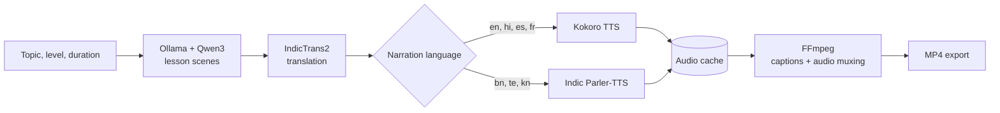

<div align="center">

# Blu Visual Teacher

**Turn any topic into a short, narrated visual lesson, in your language, fully offline.**


</div>

---

## Table of contents

- [Overview](#overview)
- [Features](#features)
- [How it works](#how-it-works)
- [Supported languages](#supported-languages)
- [Requirements](#requirements)
- [Installation](#installation)
- [Running the app](#running-the-app)
- [Configuration](#configuration)
- [Usage](#usage)
- [Project structure](#project-structure)
- [API reference](#api-reference)
- [Troubleshooting](#troubleshooting)
- [Development](#development)
- [Contributing](#contributing)
- [License](#license)
- [Third-party licenses and attributions](#third-party-licenses-and-attributions)
- [Acknowledgments](#acknowledgments)

---

## Overview

Blu Visual Teacher creates short narrated lessons from a topic, a learning level and a duration (60 or 120 seconds). It runs as a local web app: a React frontend talks to a FastAPI backend that writes the lesson scenes, translates narration and captions, synthesizes speech, and exports finished MP4 videos.

Everything runs on your own machine using local models, so lessons can be created in places with little or no internet access.

## Features

- **Topic to lesson:** generates scene-by-scene explanations with a local LLM (Ollama + Qwen3), with an offline template fallback when Ollama is unavailable.
- **Multilingual:** narration and captions are separate language tracks, so you can, for example, speak Hindi and caption in English.
- **Local text-to-speech:** Kokoro for English, Hindi, Spanish and French; Indic Parler-TTS for Bengali, Telugu and Kannada. Audio is cached per scene.
- **Local translation:** AI4Bharat IndicTrans2 for Indian languages.
- **MP4 export:** narrated video with embedded captions rendered in script-aware Noto Sans fonts.
- **Studio preview:** timeline, audio and captions stay synchronized per scene.
- **Local storage:** lessons and background job status are stored in SQLite.

## How it works



## Supported languages

Availability depends on the model files installed on your computer. The backend reports live readiness at `/api/languages`.

| Language | Translation | Narration |
| --- | --- | --- |
| English | Source language | Kokoro, voice `af_heart` |
| Hindi | IndicTrans2 (local fallbacks may be available) | Kokoro, voice `hf_alpha` |
| Bengali | IndicTrans2 (local fallbacks may be available) | Indic Parler-TTS, speaker Aditi |
| Kannada | IndicTrans2 (local fallbacks may be available) | Indic Parler-TTS, speaker Anu |
| Telugu | IndicTrans2 (local fallbacks may be available) | Indic Parler-TTS, speaker Lalitha |
| Spanish | Local translation provider, when available | Kokoro, voice `ef_dora` |
| French | Local translation provider, when available | Kokoro, voice `ff_siwis` |

Kokoro and Indic Parler-TTS load on first use and are reused by the backend process. MP4 captions use the bundled Noto Sans fonts for Devanagari, Bengali, Kannada and Telugu.

## Requirements

| Requirement | Notes |
| --- | --- |
| Windows 10/11 with PowerShell | The launcher scripts target Windows |
| Python 3.11 | 3.12+ and 3.14 are not supported by the pinned model dependencies |
| Node.js and npm | For the Vite/React frontend |
| FFmpeg | Must include the `drawtext` filter and text shaping (HarfBuzz) support |
| Ollama with `qwen3:4b` | For topic-specific lesson writing (optional, a template fallback exists) |
| Local model assets | For the narration and translation languages you plan to use |
| Disk space | Roughly 10 GB for models and caches |
| Hugging Face account | Needed once to accept the terms of the gated Indic Parler-TTS model |

> **Performance note:** on CPU, Indic Parler-TTS runs roughly 6x slower than real time. Narration is generated in the background and cached, so repeat lessons are instant. A GPU speeds this up considerably.

## Installation

The model files are intentionally kept outside the Git repository. This guide assumes the layout below.

```
C:\Users\<you>\hackathon-tts\
├── venv311\                  # Python 3.11 virtual environment
├── models\                   # model assets (not in Git)
├── tools\ffmpeg\...          # FFmpeg build (not in Git)
└── Blu-Visual-Teacher\       # this repository
```

### 1. Clone the repository

```powershell
cd C:\Users\<you>\hackathon-tts
git clone <your-repository-url> Blu-Visual-Teacher
```

### 2. Create the Python 3.11 environment

```powershell
cd C:\Users\<you>\hackathon-tts
py -3.11 -m venv venv311
.\venv311\Scripts\Activate.ps1
python -m pip install --upgrade pip
```

### 3. Install the model dependencies

Install PyTorch first (CPU shown; use the CUDA index URL from pytorch.org for NVIDIA GPUs), then the speech libraries:

```powershell
pip install torch torchaudio
pip install soundfile numpy sentencepiece sacremoses nltk
pip install git+https://github.com/huggingface/parler-tts.git
pip install kokoro-onnx onnxruntime
```

> **Keep the pinned versions.** Parler-TTS requires specific `transformers` and `huggingface_hub` versions. Do not run `pip install -U` on them, and avoid installing packages that upgrade them. Once everything works, snapshot the environment with `pip freeze > requirements-working.txt`.

The small `backend/requirements.txt` does not include the heavy model packages above. Install them in the same environment that runs the backend.

### 4. Download the model assets

| Asset | Default location |
| --- | --- |
| Kokoro ONNX model | `hackathon-tts\models\kokoro-v1.0.onnx` |
| Kokoro voice data | `hackathon-tts\models\voices-v1.0.bin` |
| IndicTrans2 checkpoint | `hackathon-tts\models\indictrans2-en-indic-dist-200M` |
| FFmpeg executable | `hackathon-tts\tools\ffmpeg\ffmpeg-9.0.2-essentials_build\bin\ffmpeg.exe` |

**Indic Parler-TTS (gated model).** Accept the terms on the [model page](https://huggingface.co/ai4bharat/indic-parler-tts) with your Hugging Face account, then log in and let it cache once:

```powershell
hf auth login
python -c "from parler_tts import ParlerTTSForConditionalGeneration as P; P.from_pretrained('ai4bharat/indic-parler-tts')"
```

**IndicTrans2.** Download the checkpoint once while online:

```powershell
python -c "from huggingface_hub import snapshot_download as d; print(d('ai4bharat/indictrans2-en-indic-dist-200M'))"
```

Point `BLU_INDICTRANS2_MODEL` at the resulting folder (see [Configuration](#configuration)).

**Ollama.**

```powershell
ollama pull qwen3:4b
ollama list
```

### 5. Install frontend dependencies

```powershell
cd C:\Users\<you>\hackathon-tts\Blu-Visual-Teacher
npm.cmd install
```

### 6. Verify offline readiness

Run the backend with `HF_HUB_OFFLINE=1` and open `/api/languages`. Every language you plan to demo should report as ready. If a model is missing from the local cache, that language will not work offline.

## Running the app

Open two PowerShell windows.

**Backend**

```powershell
cd C:\Users\<you>\hackathon-tts\Blu-Visual-Teacher
.\backend\run_backend.bat
```

The launcher prefers `hackathon-tts\venv311`, then a sibling `venv`, then the project `.venv`. It installs the backend's declared requirements and starts FastAPI on `http://127.0.0.1:8000`.

Start Ollama separately if you want Qwen-powered lesson writing. If it is unavailable, lesson creation uses the offline template, which is less topic-specific.

**Frontend**

```powershell
npm.cmd run dev
```

Open the URL printed by Vite, usually `http://localhost:5173`. Vite proxies `/api` requests to the backend.

**Production build**

```powershell
npm.cmd run build
```

The bundle is written to `dist/`. Serve it with a web server that also routes `/api` to the backend.

## Configuration

Set these environment variables in the PowerShell window before launching the backend when your assets live elsewhere.

| Variable | Purpose |
| --- | --- |
| `BLU_FFMPEG` | FFmpeg executable path or command name |
| `BLU_KOKORO_MODEL` | Kokoro ONNX model path |
| `BLU_KOKORO_VOICES` | Kokoro voice data path |
| `BLU_PARLER_MODEL` | Parler model identifier (default `ai4bharat/indic-parler-tts`) |
| `BLU_PARLER_MODEL_DIR` | Local Parler model directory |
| `BLU_INDICTRANS2_MODEL` | Local IndicTrans2 checkpoint directory |
| `BLU_USE_OLLAMA` | Enable or disable Ollama lesson generation |
| `BLU_OLLAMA_MODEL` | Ollama model name (default `qwen3:4b`) |
| `BLU_CORS_ORIGINS` | Comma-separated allowed frontend origins |
| `BLU_DATA_DIR` | SQLite database directory |
| `BLU_GENERATED_DIR` | Generated media and export directory |
| `BLU_AUDIO_CACHE_DIR` | Cached narration WAV directory |

Example:

```powershell
$env:BLU_FFMPEG = 'C:\path\to\ffmpeg.exe'
$env:BLU_INDICTRANS2_MODEL = 'C:\Users\<you>\hackathon-tts\models\indictrans2-en-indic-dist-200M'
$env:HF_HUB_OFFLINE = '1'
.\backend\run_backend.bat
```

Restart the backend after changing environment variables or installing model dependencies.

## Usage

1. Start the backend, Ollama (for Qwen lessons) and the frontend.
2. Open **Languages** to check which translation and narration assets were detected.
3. Enter a topic and choose a learning level, duration, narration language and caption language.
4. Generate the lesson. The backend writes the scenes and starts narration generation in the background.
5. Preview the lesson in **Lesson Studio**. Timeline, audio and captions are synchronized per scene.
6. Click **Export** to render an MP4. Blu renders the scenes, muxes the cached narration and embeds captions. Progress and errors are shown in the app.

## Project structure

```
Blu-Visual-Teacher/
├── backend/
│   ├── run_backend.bat       # Windows launcher
│   ├── requirements.txt      # lightweight backend requirements
│   ├── tests/                # API tests
│   ├── data/                 # SQLite database (generated, not in Git)
│   └── generated/            # audio cache and MP4 exports (generated, not in Git)
├── public/
│   └── fonts/                # bundled Noto Sans fonts and their licenses
├── src/                      # React frontend
└── dist/                     # production build output (generated)
```

Local data written at runtime:

| Data | Location |
| --- | --- |
| SQLite database | `backend/data/blu.sqlite3` |
| Narration audio cache | `backend/generated/audio_cache/` |
| MP4 exports | `backend/generated/exports/` |

These files are local application data and are excluded from source control.

## API reference

With the backend running, interactive docs are at [http://127.0.0.1:8000/docs](http://127.0.0.1:8000/docs).

| Method and route | Purpose |
| --- | --- |
| `GET /api/health` | Backend and provider readiness |
| `GET /api/languages` | Translation, narration and caption availability per language |
| `GET /api/diagnostics` | Detailed diagnostics (detected checkpoints and providers) |
| `POST /api/lessons` | Create a lesson |
| `GET /api/lessons` | List saved lessons |
| `GET /api/lessons/{id}` | Retrieve a saved lesson |
| `POST /api/narration/generate` | Generate narration for a lesson |
| `GET /api/narration/status` | Narration job and per-scene progress |
| `POST /api/lessons/{id}/exports` | Queue an MP4 export |
| `GET /api/jobs/{id}` | Background job progress |
| `GET /api/exports/{id}` | Download a completed MP4 |
| `GET /api/settings` | Read selected local settings |

## Troubleshooting

<details>
<summary><strong>The app says the backend is offline</strong></summary>

- Confirm the backend window shows Uvicorn running on port 8000.
- Open `http://127.0.0.1:8000/api/health`.
- If port 8000 is in use, stop the existing backend process before starting another.
- Make sure the frontend runs on a Vite URL allowed by `BLU_CORS_ORIGINS`.
</details>

<details>
<summary><strong>Lesson generation fails or is too generic</strong></summary>

- Confirm Ollama is running and `qwen3:4b` is installed (`ollama list`).
- Without Ollama, the offline template creates a lesson but with less topic-specific content.
- If the model returns a short explanation, retry after checking that Ollama is responsive.
</details>

<details>
<summary><strong>"No installed narration voice" or audio is missing for a language</strong></summary>

- Check `/api/languages` and `/api/diagnostics` for detected checkpoints and providers.
- Verify the backend uses the Python 3.11 environment that contains the Parler-TTS and Kokoro packages.
- Make sure model weights are already cached locally before enabling `HF_HUB_OFFLINE=1`.
- Restart the backend after installing dependencies or changing environment variables.
</details>

<details>
<summary><strong>Indic Parler-TTS fails with a 401 or 403 error</strong></summary>

The model is gated. Accept its terms on Hugging Face with the same account you log in with (`hf auth login`), then retry. Access may take a few minutes to be granted.
</details>

<details>
<summary><strong>Dependency errors such as "huggingface-hub ... is required"</strong></summary>

Parler-TTS needs specific `transformers` and `huggingface_hub` versions. Reinstall the pinned versions, for example `pip install "huggingface_hub>=0.23.2,<1.0"`, and avoid `pip install -U` on those packages.
</details>

<details>
<summary><strong>A package fails to build with "Microsoft Visual C++ 14.0 or greater is required"</strong></summary>

Use Python 3.11 so prebuilt wheels are available. If a package still needs compiling, install the Microsoft C++ Build Tools, or avoid that package (for example, IndicTrans2 can be used without `IndicTransToolkit`).
</details>

<details>
<summary><strong>MP4 export fails</strong></summary>

- Set `BLU_FFMPEG` to the full path of `ffmpeg.exe` and restart the backend.
- Verify FFmpeg runs: `& $env:BLU_FFMPEG -version`.
- Make sure the build includes `drawtext` and text shaping support, which Indic-script captions require.
- Read the export error in the app or at `GET /api/jobs/{id}`.
</details>

<details>
<summary><strong>Indic captions show broken or boxed characters</strong></summary>

The matching Noto Sans font for that script is not being loaded, or FFmpeg lacks text shaping support. Check `public/fonts/` and the FFmpeg build.
</details>

## Development

From the repository root:

```powershell
npm.cmd run lint
npm.cmd run build
```

Run the backend tests with the backend's Python environment:

```powershell
..\venv311\Scripts\python.exe -m pytest backend\tests
```

## Contributing

Contributions are welcome.

1. Fork the repository and create a feature branch.
2. Keep changes focused and match the existing code style.
3. Run `npm.cmd run lint`, `npm.cmd run build` and the backend tests before opening a pull request.
4. Do not commit model weights, API tokens, generated audio or exported videos.
5. Do not upgrade the pinned `transformers` or `huggingface_hub` versions without testing every language.

## License

The source code of this project is released under the [MIT License](LICENSE).

This license covers **only the code in this repository**. Models, fonts and tools used by the app are **not** distributed here and keep their own licenses, listed below.

## Third-party licenses and attributions

Licenses were accurate to the best of our knowledge when this README was written. **Always confirm the current license on each project's page before redistributing anything.**

### Models (downloaded separately, not bundled)

| Component | Used for | License |
| --- | --- | --- |
| [Kokoro-82M](https://huggingface.co/hexgrad/Kokoro-82M) and [kokoro-onnx](https://github.com/thewh1teagle/kokoro-onnx) | English, Hindi, Spanish, French narration | Apache-2.0 (model), MIT (kokoro-onnx package) |
| [Indic Parler-TTS](https://huggingface.co/ai4bharat/indic-parler-tts) (AI4Bharat) | Bengali, Telugu, Kannada narration | Apache-2.0, gated access on Hugging Face |
| [Parler-TTS](https://github.com/huggingface/parler-tts) library | Runs Indic Parler-TTS | Apache-2.0 |
| [google/flan-t5-large](https://huggingface.co/google/flan-t5-large) | Text encoder used by Parler-TTS | Apache-2.0 |
| [IndicTrans2](https://github.com/AI4Bharat/IndicTrans2) (AI4Bharat) | Translation | MIT |
| [Qwen3-4B](https://huggingface.co/Qwen/Qwen3-4B) | Lesson writing via Ollama | Apache-2.0 |

### Fonts (bundled in `public/fonts/`)

| Component | License |
| --- | --- |
| Noto Sans Devanagari, Bengali, Kannada, Telugu ([Google Fonts](https://fonts.google.com/noto)) | SIL Open Font License 1.1. The license text must stay next to the font files. |

### Tools and libraries

| Component | License |
| --- | --- |
| [FFmpeg](https://ffmpeg.org/legal.html) | LGPL 2.1+ or GPL 2+/3, depending on the build. The "essentials" Windows builds are typically GPL. FFmpeg is **not** bundled in this repository. |
| [Ollama](https://github.com/ollama/ollama) | MIT |
| [FastAPI](https://github.com/fastapi/fastapi) | MIT |
| [Uvicorn](https://github.com/encode/uvicorn) | BSD-3-Clause |
| [React](https://github.com/facebook/react) and [Vite](https://github.com/vitejs/vite) | MIT |
| [PyTorch](https://github.com/pytorch/pytorch) | BSD-3-Clause |
| [Hugging Face Transformers](https://github.com/huggingface/transformers) | Apache-2.0 |
| [SQLite](https://www.sqlite.org/copyright.html) | Public domain |

### Redistribution checklist

- Do not commit model weights, voice files or FFmpeg binaries to this repository.
- Keep the Noto Sans OFL license files beside the font files.
- Gated models such as Indic Parler-TTS require each user to accept the terms themselves.
- If you distribute a packaged build that includes FFmpeg, comply with the license of that specific FFmpeg build.
- Generated audio inherits the terms of the model that produced it. Check the model card before commercial use.

## Acknowledgments

- [AI4Bharat](https://ai4bharat.iitm.ac.in/) for Indic Parler-TTS and IndicTrans2.
- The Kokoro and kokoro-onnx maintainers for lightweight, CPU-friendly speech synthesis.
- The Qwen team and the Ollama project for local language models.
- Google and the Noto project for the Noto Sans fonts.
- Built during a hackathon.
